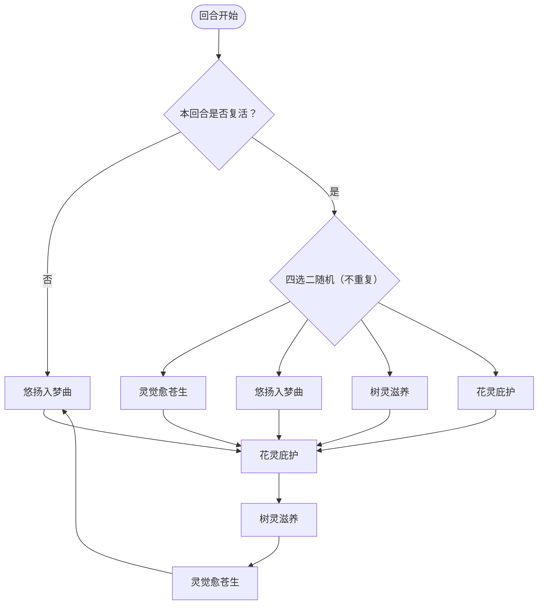

# 愈灵·克丽娅

> **类型**：精英怪物
> **初始生命**：345
> **遭遇战**：子地图活动 Boss（贪婪洞窟 / 探寻本心），常规三幕精英池不出
> **特性**：愈灵（按卡牌击杀的溢出伤害概率复活 / 非卡牌伤害击杀直接复活）+ 开局给玩家方全体 800% 永久增伤 + 高格挡高闪避

## 被动能力（开局自带）

| 名称 | 类型 | 效果 |
|------|------|------|
| **愈灵** | 能力（不可消除） | 战斗开始时，使玩家方全体获得 800% 永久增伤；受到**溢出生命值**的卡牌伤害时，按溢出数值获得等概率的复活机会；若被**非卡牌伤害**击杀，则直接复活 |

::: warning 愈灵的复活规则（本页以实际效果为准）
- **卡牌伤害击杀**：溢出多少点血，就有多少**百分比**的复活概率。例：一卡把 345 血的她打到 −50（溢出 50），则 50% 概率复活
- **溢出 0**（伤害恰好等于剩余生命）→ 复活概率 0% → **不复活**
- **溢出按格挡后的伤害计算**：若这一击大部分被格挡吃掉，溢出变小甚至为 0，就不会触发复活
- **非卡牌伤害击杀**（固定伤害、中毒等不经卡牌的伤害）→ **必定复活**
- **直接处决不触发复活**：[灾厄](/powers/doom_power.md)这类「不造成伤害、直接击杀」的效果不会进入复活判定，可以直接带走她
- **复活后回满生命**（不是回到 1 血），站起来就是满血
- 结论：想干净地结束她，就用**恰好致命**的卡牌伤害补最后一刀；越“过量”越容易让她满血站起来，固定伤害补刀必定复活
:::

::: tip 开局 800% 永久增伤是给玩家的
- 战斗开始时，愈灵会让**玩家方全体**获得 800% [永久增伤](/powers/permanent_damage_boost_power.md)，整场不消失
- 该增伤只作用于**玩家造成的攻击伤害**（×9），克丽娅自己的伤害不受影响
- 所以这场战斗的输出端极其充裕，重心应放在「精确控血、防止溢出触发复活」而不是堆伤害
:::

## 行动逻辑

常规按「悠扬入梦曲 → 花灵庇护 → 树灵滋养 → 灵觉愈苍生」固定循环；若本回合发生过复活，本回合改为从 4 个技能中随机抽 2 个（不重复）依次释放，之后回到「花灵庇护 → 树灵滋养 → 灵觉愈苍生 → 悠扬入梦曲」的循环。

> **说明**：复活当回合会把原本这一招换成「随机 2 招」，意图上直接显示抽中的两招真名与伤害；这 2 招打完后的下一回合固定接花灵庇护，再按常规顺序继续循环。复活后她是**满血**站起来的。

## 招式表

| 招式名 | 意图 | 类型 | 效果 |
|--------|------|------|------|
| **灵觉愈苍生** | 攻击 48 | 单次攻击 + 回血 | 造成 48 点伤害；将敌人弃牌堆所有卡牌的 PP 降为 0，并按降低的 PP 总量恢复等量生命 |
| **悠扬入梦曲** | 攻击 6×6 | 多段攻击 + 全场增益 | 造成 6 点伤害 × 6 次；**全场所有生物**永久获得 100% 增伤 |
| **树灵滋养** | 树灵滋养 | 自身增益 + Debuff | 自身力量/速度/命中 +5；接下来 4 回合内敌人每回合先制 -2 并受到 10 点固定伤害 |
| **花灵庇护** | 花灵庇护 | 自身增益 | 获得 200 点格挡和 30% 永久[闪避](/powers/dodge_power.md) |
| **复生双技** | 本回合抽中的两招 | 随机组合 | 复活当回合从 4 个技能中随机抽 2 个（不重复）依次释放；**意图上直接显示这两招的真名与伤害** |

::: tip 悠扬入梦曲是“双刃增伤”
- 悠扬入梦曲给的是「**全场所有生物**永久 100% 增伤」，**玩家也吃到**
- 好处：你的输出直接翻倍
- 代价：克丽娅后续的灵觉愈苍生（48 → 96）、树灵滋养（+5 力量/速度/命中后更凶）等同样翻倍；配合树灵滋养 +5 攻击，多段攻击被放大
:::

## 遭遇战

| 遭遇战 | 房间类型 | 出现位置 | 数量 | 说明 |
|--------|----------|----------|------|------|
| `SeerGreedyCaveEncounter` | Elite | 贪婪洞窟（前 5 层） | 1 只 | 4 选 1 的活动 Boss 池 |
| `SeerSeekHeartBossEncounter` | Elite | 探寻本心（低戒备） | 1 只 | 7 选 1 的活动 Boss 池 |

> ⚠️ 常规三幕精英池**不包含**克丽娅；她只作为子地图活动遭遇出现。

## 策略提示

1. **用“恰好致命”的卡牌伤害收尾**：这是本战最关键的技巧。她的复活概率 = 卡牌击杀的溢出伤害百分比；用固定伤害补刀则**必定复活**，且复活后是**满血**。把她血量精确压到某张牌的伤害值再打出，做到溢出 0，才能真正击杀。注意溢出按**扣完格挡后的伤害**计算。

2. **345 血但极难杀（复活 + 格挡 + 闪避）**：低血量是假象。花灵庇护给 200 格挡 + 30% 永久闪避，意味着你的攻击既可能被 200 格挡吃满、又有 30% 概率被闪避。需要无视格挡（固定伤害/无视格挡的攻击）才能稳定推进。

3. **悠扬入梦曲对你是净收益**：它给全场 100% 增伤，你也吃一半。所以前期（她第 1 回合必出悠扬入梦曲）不必太怕这一招，反而可以借这份增伤加速。但要警惕增伤后她后续技能同样翻倍。

4. **树灵滋养的 4 回合持续压制**：第 3 回合她会上树灵滋养，之后 4 回合你每回合先制 −2 且吃 10 点固定伤害。10 点/回合虽小，但叠加在场内其它伤害上会显著抬升你的掉血曲线，别忽视。

5. **别在弃牌堆留大量 PP 牌**：灵觉愈苍生会把弃牌堆所有牌的 PP 清零并按总量回血。弃牌堆里 PP 牌越多，她回血越猛（等于把你的资源变成她的血）。抽牌/循环时尽量把 PP 牌打出去或离开弃牌堆。

6. **复活当回合要重新规划**：一旦触发复活，她先回满生命，当回合再随机放 2 招（可能 2 个大招连发），压力骤增且无法预判。复活前最好先把血线拉满，别在残血状态下触发她的复活回合。

7. **优先在她上格挡前打空血线**：花灵庇护（第 2 回合）之后是 200 格挡，后续还有复活的格挡。要么用无视格挡的手段，要么抢在第 2 回合前的窗口尽量削血。

8. **留意固定伤害误杀，但灾厄可以直接杀**：场上的固定伤害来源（中毒、固伤遗物等）一旦在她身上结算到死，会**必定触发复活**，收尾阶段应规避；而[灾厄](/powers/doom_power.md)这类直接处决不经过伤害判定，反而能无视复活直接带走她。

## 源码

- 怪物：`SeerYulingKeliyaMonster.cs`
- 被动能力：`SeerYulingKeliyaPower.cs`（愈灵 / 复活判定）
- 技能能力：`SeerDreamSongPower.cs`（悠扬入梦曲，全场增伤）、`SeerNewSkillPowersA.cs`（树灵滋养等）、`SeerDodgePower.cs`（闪避）
- 意图：`SeerNamedSingleAttackIntent.cs`、`SeerNamedMultiAttackIntent.cs`、`SeerPuniNamedBuffIntent.cs`、`SeerDynamicIntentList.cs`（把「随机 2 招」翻译成本回合真实的两条技能意图）
- 遭遇战：`SeerYulingKeliyaEliteEncounter.cs`、`SeerSubmapEncounters.cs`
- 本地化：`monsters.json`（`SEER_MONSTER_SEER_YULING_KELIYA_MONSTER.*`）、`intents.json`（`SEER_KELIYA_*`）、`powers.json`（`SEER_POWER_SEER_YULING_KELIYA_POWER.*`、`SEER_POWER_SEER_DREAM_SONG_POWER.*`、`SEER_POWER_SEER_TREE_SPIRIT_NURTURE_POWER.*`、`SEER_POWER_SEER_DODGE_POWER.*`）
