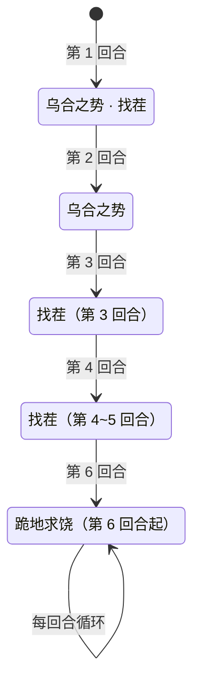

# 兹拉特

> **类型**：精英怪物
> **初始生命**：66
> **遭遇战**：子地图「激活节点」普通怪遭遇，常规三幕精英池不出
> **特性**：无被动；固定脚本出招 + 按你牌组张数打固伤 + 第 6 回合起「跪地求饶」赌命秒杀（全员闪避它才自尽）

## 被动能力（开局自带）

本怪**无开局被动能力**——它的全部威胁来自按回合固定的脚本出招。

> 说明：兹拉特是「脆皮但会秒杀」的设计——基础生命仅 66，没有增益、回血或复活机制，但第 6 回合起会用「跪地求饶」赌命，一旦掷中就把你**直接秒杀**。其唯一出场遭遇「激活节点」会把生命 ×4（264）。

## 行动逻辑

完全固定脚本，不随机：第 1 回合「乌合之势 + 找茬」→ 第 2 回合「乌合之势」→ 第 3~5 回合各「找茬」→ 第 6 回合起「跪地求饶」并永远循环。

> **说明**：第 1 回合是组合招（乌合之势→找茬，双意图）。第 3~5 回合连续三轮「找茬」。第 6 回合起只出「跪地求饶」，每回合都出、永不再回到前面的招式。

## 招式表

| 招式名 | 意图 | 类型 | 效果 |
|--------|------|------|------|
| **乌合之势 · 找茬**（第 1 回合） | 乌合之势 + 找茬 | 组合招（双意图） | 先**乌合之势**：自身全属性 +2，对敌人造成等于**其牌组张数**的[固定伤害](/powers/fixed_damage_power.md)；再**找茬**：连续攻击 4 次每次 6 点，并对所有敌人施加持续 3 回合的[麻痹](/powers/ma_power.md)和[狂暴](/powers/fury_power.md) |
| **乌合之势** | 乌合之势 | 自身增益 + 固定伤害 | 自身全属性 +2；对敌人造成等于其牌组张数的[固定伤害](/powers/fixed_damage_power.md) |
| **找茬** | 攻击 6×4 | 多段攻击 + 异常 | 连续攻击 4 次每次 6 点；对所有敌人施加持续 3 回合的[麻痹](/powers/ma_power.md)和[狂暴](/powers/fury_power.md) |
| **跪地求饶** | 跪地求饶 | 赌命秒杀 | 自身[命中](/powers/accuracy_power.md) -10；随后对每个敌人赌命：**未被闪避者被立即消灭**；若**一个敌人都没消灭**（全员闪避），自身死亡 |

::: warning 跪地求饶的真实判定（以代码为准）
- 自身[命中](/powers/accuracy_power.md) -10，按「每层负命中使目标[闪避](/powers/dodge_power.md)率 +5%」换算 → 给你的闪避率 **+50%**（再加上你自身闪避层数，上限 100%）。
- 掷骰：你**没闪避** → 你被**直接秒杀**（无视血量与格挡）；你**闪避** → 它这一轮没杀掉你。
- **自尽条件**：只有「一个敌人都没消灭」（即所有玩家都闪过）时，兹拉特才自尽；只要杀掉任意一人，它就继续活着。
- 命中是**可叠加**的：每出一轮跪地求饶再 -10。第 1 轮 -10（你 50% 闪避）、第 2 轮 -20（你 **100% 闪避**）——单人局撑到第 7 回合，它会因全员闪避而**必定自尽**。前提是你活着通过第 6 回合那次 50/50。
- 多人时对**每个**敌人单独掷骰：未闪避的玩家被秒杀；只要有**任一**玩家没闪避（被它杀掉），它就不自尽。
:::

::: warning 麻痹与狂暴是「施加给你」的，狂暴其实是增益
- [麻痹](/powers/ma_power.md)：你的攻击伤害 -10%，且每回合开始时获得 1 层[易伤](/powers/vulnerable_power.md)，回合结束 -1 层，持续 3 回合。
- [狂暴](/powers/fury_power.md)：每层使**持有者**攻击伤害 +25%，回合结束 -1 层。它被施加到你身上，**反而强化了你的输出**——这是设计上的双刃，别误判成纯削你。
:::

## 遭遇战

| 遭遇战 | 房间类型 | 出现位置 | 数量 | 说明 |
|--------|----------|----------|------|------|
| `SeerActivationNormalEncounter` | Monster | 激活节点普通怪 | 2 只或 1 只 | 50% 为两只兹拉特（生命 ×4）；否则随机一名战神联盟 Boss（生命 ×1.5） |

> ⚠️ 常规三幕精英池**不包含**兹拉特；它只作为子地图「激活节点」的活动遭遇出现。

## 策略提示

1. **基础只有 66 血，「会秒杀但很脆」**：它没有任何被动、回血、格挡或复活机制，基础生命仅 66。但注意它唯一的出场遭遇「激活节点」会把兹拉特生命 ×4（264），且有 50% 概率**两只同场**——实际要把 264 或 528 点伤害打完。**把爆发牌留到手上，尽快压死一只**是最稳的打法。

2. **第 6 回合起进入「50/50 赌命」**：跪地求饶给你 50% 闪避率，**没闪避 = 你被秒杀**（无视血量和格挡）。这一掷完全靠运气。**不要拖到第 6 回合**——第 5 回合结束前必须有把握把它打死或打残。

3. **第 7 回合它会自动输（单人局）**：若扛过第 6 回合的那次掷骰，第 2 次跪地求饶命中累计到 -20 → 你 100% 闪避 → 它没杀掉任何人 → **必定自尽**。这是保底翻盘点，但代价是**要先赌一次 50/50**，不值得主动选择。

4. **乌合之势的固伤 = 你的牌组张数，无视格挡**：第 1、2 回合各来一次。20 张牌组就吃 20，30 张就吃 30。**牌组越厚开局越痛**，且格挡无效——靠减伤/免固或干脆提前击杀规避。

5. **找茬 4×6 = 24 点连打 + 双异常 3 回合**：麻痹削你攻击并每回合叠易伤，狂暴反而给你 +25% 攻击。**注意麻痹的易伤会让你后续受击更疼**，别在麻痹期间硬吃它的大招。

6. **第 3~5 回合是最安全的输出窗口**：这 3 回合它只会重复「找茬」（24 伤 + 异常），节奏完全可预判。**把这 3 回合当作消灭它的黄金期**：前 2 回合铺好输出，第 3~5 回合连打带走。

7. **它给自己叠全属性**：乌合之势每次 +2 全属性，随属性累积它的找茬也会变疼（力量提高攻击）。**别拖太久**，越往后它的平砍越强。

8. **多人时注意赌命的分摊**：跪地求饶对每个玩家单独判定——没闪避的人被秒；只要**还有任意一人没闪避**（被它杀掉），它就继续活着；只有**全员都闪过**它才自尽。队友之间的闪避层数不同会决定谁出局，多人时更应抢在它出招前解决。

9. **无被动、无机制，纯数值怪**：只要不被跪地求饶赌中，它就是一只 66 血的靶子。**速杀顺位很低的构筑也能靠爆发碾压**；唯一要防的是把它留活到第 6 回合。

## 源码

- 怪物：`SeerZilateMonster.cs`
- 麻痹 / 狂暴：`SeerMaPower.cs`、`SeerFuryPower.cs`
- 命中 / 闪避判定：`SeerAccuracyPower.cs`、`SeerDodgePower.cs`
- 固定伤害：`SeerFixedDamagePower.cs`
- 意图：`SeerPuniNamedBuffIntent.cs`（乌合之势/跪地求饶）、`SeerNamedMultiAttackIntent.cs`（找茬）
- 遭遇战：`SeerZilateEliteEncounter.cs`、`SeerSubmapEncounters.cs`
- 本地化：`monsters.json`（`SEER_MONSTER_SEER_ZILATE_MONSTER.*`，含 `moves.COMBO_31_MOVE.title` = 乌合之势·找茬 等）、`intents.json`（`SEER_ZILATE_*`）、`powers.json`（`SEER_POWER_SEER_MA_POWER.*`、`SEER_POWER_SEER_FURY_POWER.*` 等）
