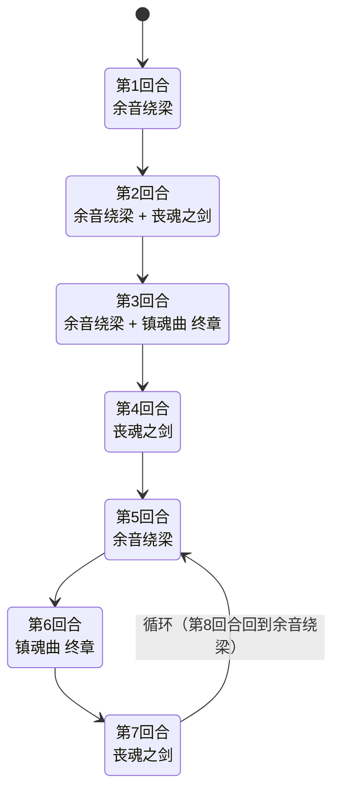

# 布鲁克

> **类型**：普通怪物
> **初始生命**：195 - 198
> **遭遇战**：第三层强怪池
> **特性**：三招联动——塞状态牌 → 消耗状态牌 → 按消耗牌堆数量平方造成伤害

## 被动能力

无。

## 行动逻辑

布鲁克开局固定 4 回合序列，之后进入 3 招循环（余音绕梁 → 镇魂曲 终章 → 丧魂之剑）。

**开局序列**（第 1~4 回合）：余音绕梁 → 余音绕梁·丧魂之剑 → 余音绕梁·镇魂曲 → 丧魂之剑

**循环阶段**（第 5 回合起）：余音绕梁 → 镇魂曲 终章 → 丧魂之剑 → 余音绕梁 → ……

> **说明**：第 1~4 回合只走一次，第 5 回合起按「余音绕梁 → 镇魂曲 终章 → 丧魂之剑」三招循环。+ 表示同一回合连续执行两招。

## 招式表

| 招式名 | 意图 | 类型 | 效果 |
|--------|------|------|------|
| **余音绕梁** | 余音绕梁 | 干扰 | 向每位玩家手牌加入 1 张[杂音](/cards/status/noise) + 3 张**灵魂** |
| **丧魂之剑** | 攻击 28 | 攻击 + 消耗 | 造成 28 点攻击伤害（受力量/易伤加成，可被格挡），将每位玩家手牌、抽牌堆、弃牌堆中所有的灵魂和状态牌移至消耗牌堆 |
| **镇魂曲 终章** | 镇魂曲 终章 | 攻击 | 造成等于每位玩家消耗牌堆数量平方的伤害（意图恒显示 0，实际伤害极高）。属于攻击伤害：受[力量](/powers/strength_power.md)/[易伤](/powers/vulnerable_power.md)加成、可被格挡，也会正常触发"受攻击时"类效果 |
| **余音绕梁·丧魂之剑** | 余音绕梁 + 丧魂之剑（双意图） | Combo | 依次执行余音绕梁和丧魂之剑 |
| **余音绕梁·镇魂曲** | 余音绕梁 + 镇魂曲 终章（双意图） | Combo | 依次执行余音绕梁和镇魂曲 终章 |

::: warning 招式联动链
1. **余音绕梁**向手牌塞 4 张状态牌（1 杂音 + 3 灵魂）
2. **丧魂之剑**把这些状态牌全部移到消耗牌堆
3. **镇魂曲 终章**按消耗牌堆数量平方造成伤害

消耗牌堆越多，镇魂曲 终章越致命：4 张 = 16 伤，6 张 = 36 伤，8 张 = 64 伤。
:::

::: warning 镇魂曲 终章的伤害类型
镇魂曲 终章是标准的怪物攻击伤害：
- ✅ 受[力量](/powers/strength_power.md)加成
- ✅ 受[易伤](/powers/vulnerable_power.md)加成（1.5 倍）
- ✅ 可被**格挡**抵消
- ✅ 会正常触发"受攻击时"效果——荆棘反伤、[振翅](/powers/flutter_power.md)减层、受击获得 X 等都照常生效
- 意图伤害显示为 0，必须自行计算消耗牌堆数量平方
:::

## 特殊状态牌

| 牌名 | 类型 | 效果 |
|------|------|------|
| [杂音](/cards/status/noise) | 状态牌 | 保留 + 消耗。打出后给你挂上"杂音复制"：你的回合结束时，手牌中每张杂音各复制 1 张到手牌 |
| **灵魂** | 状态牌（原版） | 抽 1 张牌 |

::: tip 杂音的增殖性
杂音本身"保留 + 消耗"：不打出时会一直占着手牌但不增殖；一旦你打出任意一张杂音，就会获得杂音复制——之后每个你的回合结束时，手牌里每张杂音都复制 1 张，手牌会越滚越多。丧魂之剑会把杂音移到消耗牌堆，反而让镇魂曲 终章更痛——但如果不移走杂音，手牌会被挤爆。这是一个两难选择。
:::

## 遭遇战

| 遭遇战 | 池子 | 数量 | 说明 |
|--------|------|------|------|
| 强怪池 | 强怪池 | 1 只 | 单只布鲁克 |

## 策略提示

1. **镇魂曲 终章的意图显示是 0，别被骗了**：镇魂曲 终章的意图显示伤害为 0，但实际造成消耗牌堆数量平方的伤害。消耗牌堆 5 张 = 25 伤，8 张 = 64 伤。看到镇魂曲 终章意图时，必须根据当前消耗牌堆数量预判真实伤害。**此伤害可被格挡**（不是不可格挡伤害），但意图不显示数值，需要主动计算并准备格挡牌。

2. **开局 4 回合序列是最大威胁窗口**：第 2 回合 Combo「余音绕梁·丧魂之剑」同时塞牌 + 消耗，第 3 回合 Combo「余音绕梁·镇魂曲」塞牌 + 平方伤害。到第 3 回合时消耗牌堆可能已有 6~8 张（4 张状态牌 + 玩家自己消耗的牌），镇魂曲可能造成 36~64 伤。**第 3 回合前**必须准备足够格挡。

3. **杂音会增殖，但不能不处理**：杂音带保留，不打出就只是占位；一旦打出就会获得"杂音复制"，之后每回合结束手牌里的杂音都会翻倍增长。但丧魂之剑把杂音移到消耗牌堆后，镇魂曲 终章会更痛。最佳策略是在丧魂之剑之前用其他方式弃掉杂音，减少进入消耗牌堆的数量。

4. **不要主动消耗自己的牌**：布鲁克的镇魂曲 终章按消耗牌堆总数量平方计算伤害，包括你自己消耗的牌。打布鲁克时尽量避免使用消耗类卡牌，否则在给镇魂曲 终章递弹药。

5. **丧魂之剑只移灵魂和状态牌**：丧魂之剑只移动手牌、抽牌堆、弃牌堆中的灵魂和状态牌到消耗牌堆，不会影响普通牌。所以不用担心核心牌被消耗，但要留意消耗牌堆的总量增长。

6. **镇魂曲 终章会触发受击效果**：它虽然是"看不见数值"的攻击，但仍按攻击伤害结算——荆棘会反伤、振翅会掉层、受击触发的能力都生效。想让反伤/受击流发挥作用，这回合正是机会；反过来说，依赖"打不动"的减伤不能指望它绕开。

7. **195~198 血量需要持续输出**：布鲁克血量偏高，需要 4~5 回合的持续输出才能击杀。关键是控制消耗牌堆数量在安全线以下（建议 ≤ 4 张，镇魂曲最多 16 伤）。

## 源码

- 怪物：`SeerBulukeMonster.cs`
- 遭遇战：`SeerBulukeStrongEncounter.cs`
- 本地化：`monsters.json`、`intents.json`、`cards.json`
