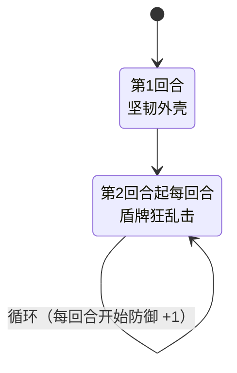

# 防御史莱姆

## 基本信息

| 属性 | 数值 |
|---|---|
| 分类 | [普通怪物](/monsters/normal/) |
| 生命值 | 51 - 53 |
| 被动能力 | [防御](#防御2-层)（2 层）+ [王者之灵](#王者之灵1-层)（1 层） |

## 行动逻辑

首回合固定使用「坚韧外壳」叠加硬化外壳，之后每回合都用「盾牌狂乱击」输出。

## 招式表

| 招式 | 意图 | 描述 | 数值 |
|---|---|---|---|
| 盾牌狂乱击 | 攻击 | 造成12点伤害，附加等于自身**防御**层数的**固定伤害**。 | 基础伤害 12 + 固定伤害（= 防御层数） |
| 坚韧外壳 | 坚韧外壳 | 自身获得**最大生命30%**的**硬化外壳**。 | 硬化外壳 = 最大生命 × 30% |

## 被动能力

### 防御（2 层）

每有一层，受到的攻击伤害降低 1 点。

- **初始层数**：2（怪物加入房间时施加）。
- **持续累积**：王者之灵每回合开始时再 +1 层防御，层数会随回合数持续增长。
- **能力类型**：Buff，可被消除 buff 类效果清除。
- **与招式联动**：「盾牌狂乱击」的固定伤害 = 当前防御层数，所以防御越高，固定伤害越高。

### 王者之灵（1 层）

获得 2 层**防御**。在其回合开始时获得 1 层**防御**。

- **初始层数**：1（怪物加入房间时施加）。
- **效果**：仅负责每回合开始时 +1 层防御。开局 2 层防御由怪物加入房间时直接施加（能力描述中"获得2层防御"指此开局行为）。
- **能力类型**：不可消除（不被消除 buff/debuff 类效果清除）。

## 遭遇战

| 遭遇战 | 房间类型 | 池子 | 数量 | 说明 |
|---|---|---|---|---|
| `SeerDefenseSlimeWeakEncounter` | Monster | 弱怪池 | 1 只 | 位置 defenseslime1 |
| `SeerDefenseSlimeTripleWeakEncounter` | Monster | 弱怪池 | 3 只 | 位置 slime1/slime2/slime3 |
| `SeerLeafSlimeDefenseStrongEncounter` | Monster | 强怪池 | 2 只 | 树叶史莱姆（中）×1（位置 leaf1）+ 防御史莱姆 ×1（位置 slime1） |

## 策略提示

1. **固定伤害威胁是核心**：「盾牌狂乱击」除基础 12 点攻击伤害外，还施加 = 当前防御层数 的[固定伤害](/mechanics/fixed-damage)（下回合开始时结算，无法格挡）。固定伤害无法被格挡，只能靠[固定伤害免疫](/powers/immune_fixed_damage_power.md)或恢复生命来应对。

2. **防御持续滚雪球**：开局 2 层防御，之后每个怪物回合开始时 +1（王者之灵）。注意第 1 回合开始时就已经加过 1 层，所以第 1 回合行动时防御已是 3：

   | 回合 | 行动时防御层数 | 固定伤害（=防御） | 总伤害（12+固定） |
   |------|----------|---------------------|-------------------|
   | 第 1 回合（坚韧外壳） | 3 | 不攻击 | — |
   | 第 2 回合 | 4 | 4 | 16 |
   | 第 3 回合 | 5 | 5 | 17 |
   | 第 5 回合 | 7 | 7 | 19 |
   | 第 8 回合 | 10 | 10 | 22 |

   回合越久固定伤害越高，且无法格挡。必须在 3 回合内击杀，否则固定伤害会压垮你的血量。

3. **硬化外壳按最大生命缩放**：第 1 回合「坚韧外壳」获得 = 最大生命 × 30% 的硬化外壳。普通难度下（生命 51-53）为 15 层——效果是**每个怪物回合承受的 HP 损失上限为 15**（不是 15 次免伤），每回合重置。所以爆发再高也最多打掉 15 血，51~53 血至少要 4 个回合才能磨完；精英化或 Boss 化时生命值更高，上限也更厚。

4. **消除 Buff 可破防御**：防御是 Buff 类型，可被消除 Buff 类卡牌清除。清除后盾牌狂乱击的固定伤害归零，只剩 12 点基础攻击伤害。但王者之灵本身不可消除，每回合仍会继续 +1 防御。需在消除防御后的同一回合或下回合立即爆发输出，否则防御又会重新累积。

5. **三只共斗前期几乎压不动血**：三只防御史莱姆遭遇战中，3 只同时叠防御和外壳——第 1 回合 3 只各自坚韧外壳（每只每回合最多掉 15 血），第 2 回合起 3 只同时盾牌狂乱击。硬化外壳对所有伤害类型都生效（固定伤害、流失伤害也一样被 15 点上限卡住），所以不要指望穿透；正确打法是每回合尽量打满 15 点、用 4 个回合磨死一只，同时优先集火把 3 只的威胁降到 2 只再到 1 只。固定伤害能绕过的是「防御」对攻击伤害的减免，不是外壳上限。

6. **坚韧外壳回合是安全输出窗口**：第 1 回合防御史莱姆只使用「坚韧外壳」不攻击，是安全的输出时间。但此回合起它每回合最多掉 15 血，打多少段都一样——所以第 1 回合可以放心输出，不必刻意留牌；真正要做的是把战斗压缩在 4 个回合左右结束，避免固定伤害滚起来。

## 源码

- 怪物：`SeerDefenseSlimeMonster.cs`
- 被动能力：`SeerDefensePower.cs`（防御）、`SeerKingsSpiritPower.cs`（王者之灵，每回合 +1 防御）
- 遭遇战：`SeerDefenseSlimeWeakEncounter.cs`、`SeerDefenseSlimeTripleWeakEncounter.cs`、`SeerLeafSlimeDefenseStrongEncounter.cs`
- 本地化：`monsters.json`（`SEER_MONSTER_SEER_DEFENSE_SLIME_MONSTER.*`）、`intents.json`（`SEER_SHIELD_FRENZY.*`、`SEER_TOUGH_SHELL.*`）、`powers.json`（`SEER_POWER_SEER_DEFENSE_POWER.*`、`SEER_POWER_SEER_KINGS_SPIRIT_POWER.*`）
