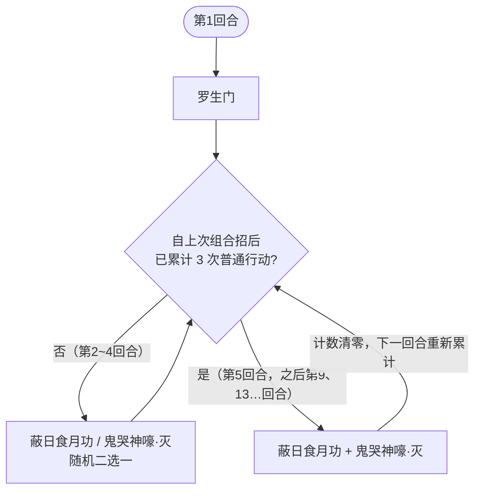

# 斗神瑞尔斯

## 基本信息

| 属性 | 数值 |
|---|---|
| 分类 | [普通怪物](/monsters/normal/) |
| 生命值 | 122 - 125 |

## 被动能力

无开局被动。罗生门与蔽日食月功都由招式施加。

## 行动逻辑

开局固定使用一次「罗生门」（不累计行动计数），之后进入主分支：每累计 3 次普通行动，下一次行动替换为组合招式「蔽日食月功·鬼哭神嚎」（首次在第 5 回合），其余回合在「蔽日食月功」与「鬼哭神嚎·灭」之间随机二选一。

> **说明**：罗生门只放一次；组合招不会连续出现，每次组合招之后要再走 3 个随机回合。

## 招式表

| 招式 | 意图 | 描述 | 数值 |
|---|---|---|---|
| 罗生门 | 罗生门 | 自身免疫异常状态，你的 PP 消耗额外 +2，持续 5 回合。 | 自身罗生门 5 层 |
| 蔽日食月功 | 蔽日食月功 | 自身获得 4 回合吃月亮：每回合回复最大生命 1/4，并对敌人造成实际回复量 20% 的固定伤害。 | 吃月亮 4 回合 |
| 鬼哭神嚎·灭 | 鬼哭神嚎·灭 | 造成 18 点伤害。若自身当前生命大于你，伤害翻倍。 | 伤害 18（翻倍 36） |
| 蔽日食月功·鬼哭神嚎 | 蔽日食月功 + 鬼哭神嚎·灭 | 组合招式：依次执行蔽日食月功与鬼哭神嚎·灭。 | 同上两项 |

## 遭遇战

| 遭遇战 | 房间类型 | 池子 | 数量 | 说明 |
|---|---|---|---|---|
| `SeerDoushenRuiersiStrongEncounter` | Monster | 强怪池 | 1 只 | 单只斗神瑞尔斯 |
| `SeerEventGaiaRuiersiEncounter` | Monster | 事件遭遇战 | 2 只 | 1 盖亚（第一层 Boss）+ 1 斗神瑞尔斯；无奖励 |

## 策略提示

1. **罗生门的开局压制——PP 消耗 +2 与免疫异常**：首回合即施加 5 层罗生门，使你的每张 PP 牌 PP 消耗额外 +2（原本 1 PP 变 3 PP，原本 2 PP 变 4 PP），并免疫异常状态。PP 是单场战斗资源，每场战斗开始时重置为 MaxPp。罗生门覆盖 5 个玩家回合，期间 PP 牌变贵——务必准备低 PP 消耗或 0 PP 的卡牌过渡，避免 PP 被快速耗尽后无法出牌。

2. **蔽日食月功改为 4 回合吃月亮**：不再按已损失生命回血，而是施加 4 层吃月亮。之后每个斗神瑞尔斯回合开始时回复自身最大生命 1/4（约 30~31），并对每个敌人施加等于本次实际回复量 20% 的[固定伤害](/mechanics/fixed-damage)（约 6 点，下回合开始结算，无法格挡）。这是一个持续 4 回合的回复+固伤循环，越拖越难压血。优先用爆发伤害在吃月亮生效前击杀。

3. **鬼哭神嚎·灭的斩杀线——血量对比翻倍**：鬼哭神嚎·灭造成 18 点攻击伤害；若自身当前生命大于任一敌方当前生命，伤害翻倍至 36。注意触发条件是"大于任一敌方"——多人模式下只要有一个玩家血量低于斗神瑞尔斯就触发翻倍。保持自身血量高于对方以规避翻倍，或准备 36 格挡应对。

4. **组合招式节奏——第 5 回合首次触发**：罗生门之后的普通行动累计到 3 次，下一次行动才会变成「蔽日食月功·鬼哭神嚎」组合招。因此首次组合招在第 5 回合，之后是第 9、13…回合（每 3 个随机回合插 1 个组合回合）。组合招回合会刷新吃月亮并立即打一次 18/36 攻击，需预留防御资源。其余回合在蔽日食月功与鬼哭神嚎·灭之间随机二选一（各 50%）。

5. **罗生门免疫异常但可被直伤击杀**：罗生门让斗神瑞尔斯免疫异常状态（中毒/烧伤/麻痹/睡眠/冻伤等全部无效），但不会免疫直接伤害或固定伤害。中毒流/异常流牌组对斗神瑞尔斯完全无效，必须依靠直伤或[固定伤害](/mechanics/fixed-damage)。罗生门持续 5 回合后自然消失，之后异常状态才可生效——但通常战斗在 5 回合内已结束。

6. **盖亚同场的双重压制**：事件遭遇战中盖亚（第一层 Boss）+ 1 只斗神瑞尔斯同场，无奖励。盖亚有自己的属性反转机制，斗神瑞尔斯有罗生门 PP 加价和蔽日食月功回血。两只同时施压，PP 消耗变高后输出能力下降，同时还要应对盖亚的机制。状态不好建议跳过这个事件。

7. **122~125 血需要 3~4 回合击杀**：斗神瑞尔斯血量中等，配合吃月亮的持续回血和罗生门 PP 加价，实际战斗时间可能拖长。建议在罗生门持续期间用低 PP 卡牌过渡，等吃月亮剩余层数降低后再爆发。最优策略是在 2~3 回合内集中火力一击秒杀，避免陷入回复+固定伤害的滚雪球循环。

## 源码

- 怪物：`SeerDoushenRuiersiMonster.cs`
- 遭遇战：`SeerDoushenRuiersiStrongEncounter.cs`、`SeerEventGaiaRuiersiEncounter.cs`
- 本地化：`monsters.json`（`SEER_MONSTER_SEER_DOUSHEN_RUIERSI_MONSTER.*`）、`intents.json`（`SEER_RASHOMON.*`、`SEER_ECLIPSE_MOON.*`、`SEER_GHOST_CRY.*`）
