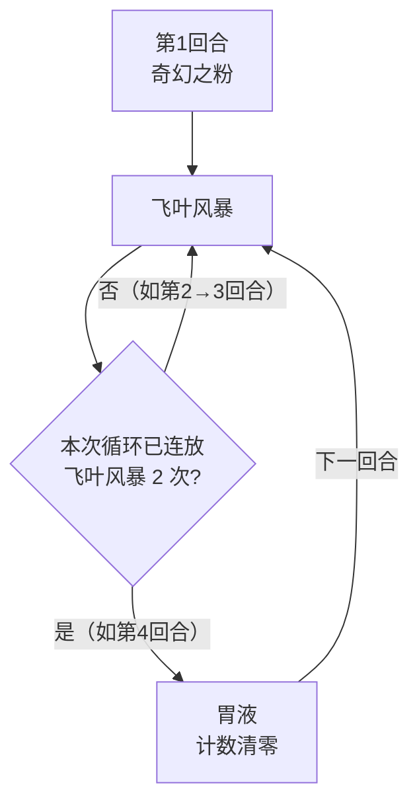

# 魔花仙子

## 基本信息

| 属性 | 数值 |
|---|---|
| 分类 | [普通怪物](/monsters/normal/) |
| 生命值 | 48 - 50 |
| 被动能力 | 无 |

## 被动能力

无被动能力。

## 行动逻辑

开局先施放「奇幻之粉」，随后进入「飞叶风暴 × 2 → 胃液」的循环：每两次飞叶风暴后接一次胃液，胃液把计数清零后再次进入两连飞叶风暴。

> **说明**：奇幻之粉只放第 1 回合；之后固定是两次飞叶风暴接一次胃液，可精确预判。

## 招式表

| 招式 | 意图 | 描述 | 数值 |
|---|---|---|---|
| 奇幻之粉 | 奇幻之粉 | 对你施加**麻痹**2层、**中毒**2层、**睡眠**2层。 | 麻痹/中毒/睡眠 各 2 层 |
| 飞叶风暴 | 飞叶风暴 | 造成3点伤害5次。 | 伤害 3，命中 5 次（总伤 15） |
| 胃液 | 胃液 | 解除自身所有属性下降（负值归零），反转你所有的属性强化。 | — |

## 遭遇战

| 遭遇战 | 房间类型 | 池子 | 数量 | 同场怪物 | 说明 |
|---|---|---|---|---|---|
| `SeerMagicFlowerWeakEncounter` | Monster | 弱怪池 | 1 只 | — | — |
| `SeerMagicFlowerCactusStrongEncounter` | Monster | 强怪池 | 2 只 | [仙人掌](../normal/cactus_monster.md) | — |
| `SeerSeapunkMagicFlowerStrongEncounter` | Monster | 强怪池 | 2 只 | 海洋混混 | — |
| `SeerShrinkerBeetleMagicFlowerStrongEncounter` | Monster | 强怪池 | 2 只 | 缩小甲虫 | — |

## 策略提示

1. **奇幻之粉的三重异常威胁**：开局直接施加[麻痹](/powers/ma_power.md) 2 层 + [中毒](/powers/poison_power.md) 2 层 + [睡眠](/powers/sleep_power.md) 2 层。麻痹和睡眠都会降低你的攻击伤害，麻痹还会在你回合开始时额外塞 1 层易伤；中毒在你回合开始时扣 2 点伤害后层数减半；睡眠在你受到未被格挡的伤害时直接解除。三者叠加让你下回合输出大减并持续掉血。建议开局立即用解异常卡牌或遗物应对，或在魔花仙子行动前打出爆发击杀。

2. **飞叶风暴总伤 15，逐段结算**：飞叶风暴造成 3 点攻击伤害 × 5 次，总伤 15。每段都可被格挡独立抵挡，也会被力量加成放大。魔花仙子自己的胃液只解除自身的负属性，不会给它自己加正力量，所以它这边的伤害基本稳定在 15。48~50 血量极低，这个伤害对魔花仙子自身威胁不大。

3. **胃液强力反制属性流**：胃液解除自身所有属性下降（负值归零），并反转你所有的属性强化——你有 5 层力量，胃液会施加 -10 力量，使你从 +5 变为 -5。切勿在胃液回合前过度堆叠属性强化——你叠得越多，被反转后损失越大。建议在胃液回合前用完属性增益，或完全不叠属性、用固定伤害/流失伤害输出。

4. **48~50 血一回合可杀**：魔花仙子血量极低，前期任何中等伤害攻击牌（15~20 伤害）配合先制或速度即可一回合击杀。优先在第一回合（奇幻之粉）或第二回合（飞叶风暴）集火秒杀，避免胃液回合清掉你的属性。

5. **循环可预判——奇幻之粉 → 飞叶风暴 ×2 → 胃液 → 飞叶风暴 ×2 → 胃液 → ...**：开局奇幻之粉后进入「飞叶风暴 ×2 → 胃液」循环。奇幻之粉回合需准备解异常，飞叶风暴回合需准备 15 格挡，胃液回合不直接造成伤害但会清属性——是相对安全的输出窗口。但胃液回合你的属性会被反转，不宜在这回合前叠属性。

6. **仙人掌同场与你自己的荆棘**：仙人掌的祸移/花瓣舞叠的是它自己的荆棘，不影响你。真正相关的是你身上的荆棘——飞叶风暴的 5 段攻击每一段都会触发你的荆棘反伤，5 段 × 荆棘层数，是荆棘流打魔花仙子的主要输出。

7. **缩小甲虫同场的力量联动**：强怪池中魔花仙子与缩小甲虫同行。缩小甲虫可能施加力量削弱，魔花仙子的胃液会反转你的正向属性——双重力量削弱让你的攻击伤害大幅下降。优先击杀魔花仙子（血量低、易杀），避免胃液清属性后再处理缩小甲虫。

## 源码

- 怪物：`SeerMagicFlowerMonster.cs`
- 遭遇战：`SeerMagicFlowerWeakEncounter.cs`、`SeerMagicFlowerCactusStrongEncounter.cs`、`SeerSeapunkMagicFlowerStrongEncounter.cs`、`SeerShrinkerBeetleMagicFlowerStrongEncounter.cs`
- 本地化：`monsters.json`（`SEER_MONSTER_SEER_MAGIC_FLOWER_MONSTER.*`）、`intents.json`（`SEER_FANTASY_POWDER.*`、`SEER_LEAF_STORM.*`、`SEER_GASTRIC_JUICE.*`）
