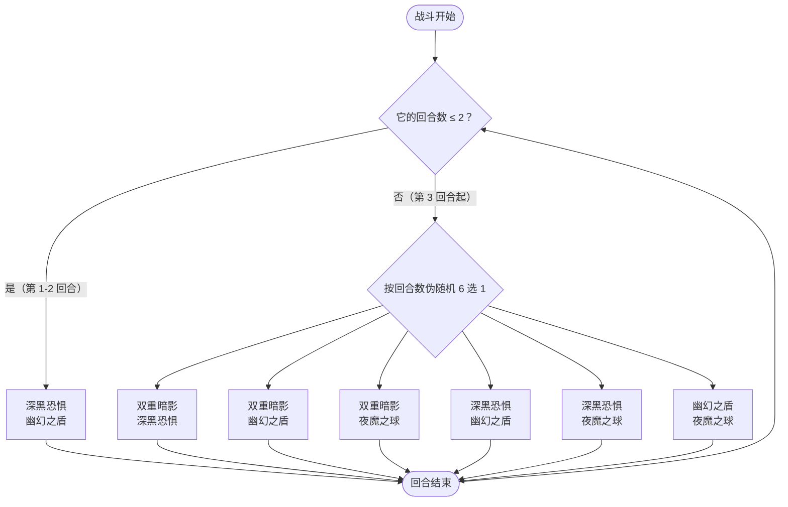

# 布莱克（幽暗之证）

> **类型**：特殊怪物（子地图变体）
> **初始生命**：156 - 166
> **遭遇战**：子地图「幽暗之证」普通节点 · 随机 1 只
> **特性**：与[布莱克](/monsters/boss/blake_monster.md)技能、被动、动画、立绘一致，仅生命替换为 156 - 166；该遭遇只生成 1 只，没有真假身三身一体

## 与本体布莱克的区别

| 项目 | 本体布莱克 | 幽暗之证版 |
| --- | --- | --- |
| 生命 | 99 - 103 | 156 - 166 |
| 三身一体 | 3 只（1 真身 + 2 假身） | 不适用——只生成 1 只，它始终是唯一真身 |
| 技能 / 被动 | 完整 | 完全继承，无改动 |
| 出场 | 第一层 Boss 池 | 只在幽暗之证房间 |

::: tip 血量口径
幽暗之证使用固定的旧版基础值（156~166），不随本体布莱克的数值调整同步。
:::

完整机制（三身一体、真假身切换、双重暗影连击削弱）见 **[布莱克](/monsters/boss/blake_monster.md)**；但本遭遇只上场 1 只，三身一体相关规则不会生效。

## 被动能力

**暗夜守护（单只出场）**：开局仍会施加暗夜守护，但场上只有这 1 只布莱克——它被登记为唯一真身，承受全额伤害，没有假身可打，也没有每回合的真身切换。

- 假身受伤固定 1 点、受伤后被击晕、真身死亡后假身逃跑等规则，在单只遭遇中都不会触发。
- 被动不可消除。

## 行动逻辑

单只布莱克仍沿用本体出招：前 2 回合固定「深黑恐惧 + 幽幻之盾」，第 3 回合起按回合数伪随机从 6 种双招组合中抽 1 种。因为没有分身，双重暗影恒为 5 段，也没有真身切换。

> 该遭遇没有其他布莱克，因此不会出现「真身随机切换」这一步；表中 6 种组合的选取依赖回合数，连续回合可能重复同一组合。

## 招式表

| 招式 | 意图 | 效果 | 数值 |
|---|---|---|---|
| 双重暗影 | 多段攻击 | 造成多次伤害；场上每有 1 个被击晕的队友，连击次数 −1（本遭遇无队友，恒为 5 次） | 7 伤害 × 5 次 |
| 深黑恐惧 | 自身增益 + 牌组污染 | 自身力量 +3；向你的抽牌堆加入 1 张随机诅咒（原版+赛尔诅咒池） | 力量 +3 |
| 幽幻之盾 | 自身增益 + 卡牌降级 | 自身获得 1 层缓冲；随机降级你 1 张已升级的牌 | 缓冲 1 层 |
| 夜魔之球 | 攻击 + 充能球 | 生成 1 个黑暗充能球并造成伤害；若你有奥斯提则伤害翻倍 | 15（有奥斯提 30） |
| 双招组合 | — | 深黑恐惧·幽幻之盾 / 双重暗影·深黑恐惧 / 双重暗影·幽幻之盾 / 双重暗影·夜魔之球 / 深黑恐惧·夜魔之球 / 幽幻之盾·夜魔之球，依次结算两招 | 与单招相同 |

## 遭遇战

| 遭遇战 | 房间类型 | 池子 | 数量 | 说明 |
|--------|----------|------|------|------|
| 幽暗之证 | Monster | 幽暗之证专属 | 1 只 | 从雷伊 / 盖亚 / 卡修斯 / 布莱克 / 缪斯五只翻倍版中随机 1 只；抽到布莱克时同样只上场 1 只，不带假身 |

## 策略提示

1. **只有一只，血量 156~166**：这条遭遇从五只翻倍版里随机抽 1 只，抽到布莱克时也只生成 1 只。没有假身分摊，也没有真身判定环节——打出去的伤害全部实打。

2. **双重暗影恒定 5 段**：本遭遇没有队友可被击晕，连击数不会下降，固定 7 × 5 = 35 点伤害。看到双重暗影意图就按 35 点留格挡。

3. **前 2 回合可以放心输出**：固定「深黑恐惧 + 幽幻之盾」，没有攻击伤害，但会力量 +3、塞 1 张诅咒、给自身 1 层缓冲、随机降级你 1 张已升级牌。趁这 2 回合把爆发打出去。

4. **第 3 回合起 6 选 1**：其中 3 种带双重暗影（50%），夜魔之球是 15 点伤害（带奥斯提时翻倍），深黑恐惧会继续叠力量并塞诅咒。组合按回合数推算，可能连续重复。

5. **子地图无真正死亡**：失败只会退出子地图，不会丢局；但血量比本体厚，拖长后力量与诅咒会累积，注意留防御。

## 源码

- 怪物：`SeerBlakeDarkProofMonster.cs`（子类，仅覆盖生命）
- 遭遇战：`SeerDarkProofEncounter.cs`
- 本地化：`monsters.json`
