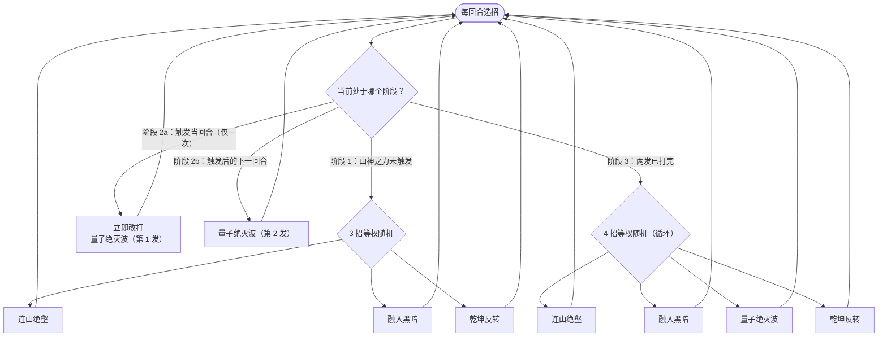

# 卡修斯（幽暗之证）

> **类型**：特殊怪物（子地图变体）
> **初始生命**：256 - 266
> **遭遇战**：子地图「幽暗之证」普通节点 · 随机 1 只
> **特性**：与[卡修斯](/monsters/boss/casius_monster.md)技能、被动、动画、立绘完全一致，仅生命改为 256 - 266

## 与本体卡修斯的区别

| 项目 | 本体卡修斯 | 幽暗之证版 |
| --- | --- | --- |
| 生命 | 150 - 153 | 256 - 266 |
| 技能 / 被动 | 完整 | 完全继承，无改动 |
| 出场 | 第一层 Boss 池 | 只在幽暗之证房间 |

::: tip 血量口径
幽暗之证使用固定的旧版基础值（256~266），不随本体卡修斯的数值调整同步。
:::

完整招式与「山神之力」等机制见 **[卡修斯](/monsters/boss/casius_monster.md)**。

## 被动能力

**山神之力（开局自带，仅触发一次）**：自身生命值首次降到最大生命的 50% 及以下时，获得 40% 减伤与壁垒（格挡回合开始不清空），并向你的抽牌堆加入 7 张随机状态牌。

- 减伤只作用于攻击伤害（攻击伤害 ×0.6）。
- 能力不可消除。

## 行动逻辑

分三个阶段，由血量阈值与量子绝灭波的使用次数驱动。触发山神之力的当回合，还没执行的那一招会被立刻换成量子绝灭波；下一回合再强制打一次量子绝灭波；之后四招随机循环。

- **阶段 1**（生命 > 50%）：连山绝壑 / 融入黑暗 / 乾坤反转 三选一，量子绝灭波权重为 0。
- **触发山神之力后**：两次量子绝灭波连打（触发当回合 + 下一回合）；壁垒让第一发的格挡留到第二发，第二发累计格挡翻倍后可达 60 点伤害。
- **阶段 3**：四招等权随机循环。

## 招式表

| 招式 | 意图 | 效果 | 数值 |
|---|---|---|---|
| 连山绝壑 | 自身增益 + 牌组污染 | 自身全属性 +2；向你的弃牌堆加入 1 张侵蚀 + 1 张枯竭 | 全属性 +2 |
| 融入黑暗 | 自身增益 + 牌组污染 + 固定伤害 | 自身获得 2 层无实体；向你的弃牌堆加入 2 张虚空；施加等于你状态牌总数的固定伤害 | 无实体 2 层；固定伤害 = 状态牌数 |
| 量子绝灭波 | 自身格挡 + 攻击 | 获得 10 点格挡并翻倍，造成等于当前格挡的伤害 | 格挡 10→20；伤害 20（第二发 60） |
| 乾坤反转 | 属性夺取 + 多段攻击 | 夺取你全部正值属性（力量/防御/命中/速度）加给自身；造成 4 点伤害 × 你状态牌总数 | 伤害 4 × 状态牌数 |

## 遭遇战

| 遭遇战 | 房间类型 | 池子 | 数量 | 说明 |
|--------|----------|------|------|------|
| 幽暗之证 | Monster | 幽暗之证专属 | 1 只 | 从雷伊 / 盖亚 / 卡修斯 / 布莱克 / 缪斯五只翻倍版中随机 1 只 |

## 策略提示

1. **山神之力的触发点被拉长**：本体在 50% 血量触发 40% 减伤 + 壁垒 + 塞 7 张状态牌。这条变体血量为 256~266，你需要先打掉 128~133 点才会看到这条线，爆发窗口与减伤窗口都更靠后。

2. **更高的血量让「山神之力」更难绕**：减伤 + 壁垒 + 状态牌三件套会显著拖慢后半程，提前准备固定伤害、状态牌清理和壁垒对策。

3. **前半程是纯输出窗口**：触发山神之力前它没有额外减伤，尽量把爆发打在这段时间，避免进减伤阶段后硬磨。

4. **子地图无真正死亡**：失败只会退出子地图，不会丢局；但仍会浪费活动进度，能稳过优先。

## 源码

- 怪物：`SeerCasiusDarkProofMonster.cs`（子类，仅覆盖生命）
- 遭遇战：`SeerDarkProofEncounter.cs`
- 本地化：`monsters.json`
