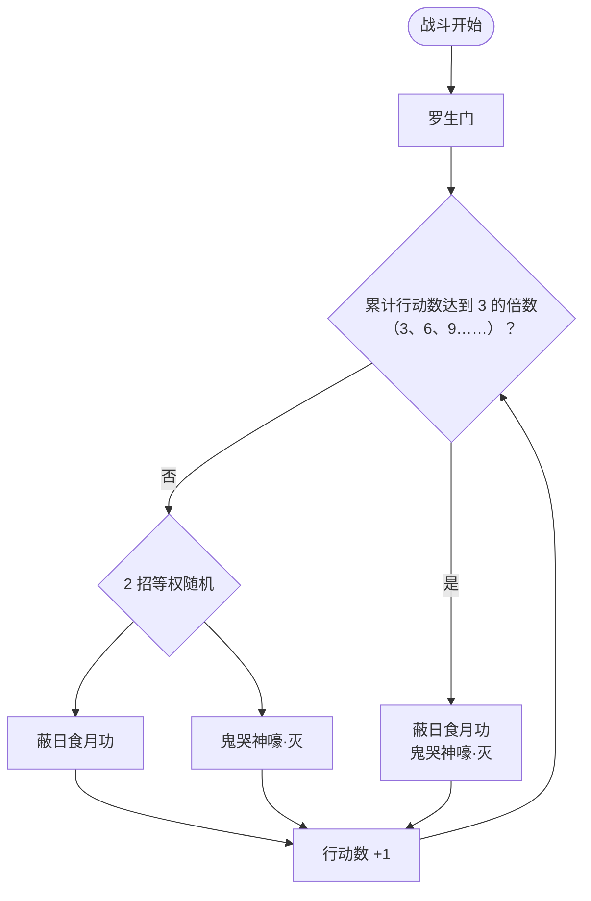

# 斗神瑞尔斯（圣光的恩泽）

> **类型**：特殊怪物（子地图变体）
> **初始生命**：450
> **遭遇战**：子地图「圣光的恩泽」普通节点
> **特性**：与[斗神瑞尔斯](/monsters/normal/doushen_ruiersi_monster.md)技能、被动、动画、立绘完全一致，仅生命改为 450

## 与本体斗神瑞尔斯的区别

| 项目 | 本体斗神瑞尔斯 | 圣光的恩泽版 |
| --- | --- | --- |
| 生命 | 122 - 125 | 450 |
| 技能 / 被动 | 完整 | 完全继承，无改动 |
| 出场 | 第二层强怪池 | 只在圣光的恩泽普通节点 |

完整招式与机制见 **[斗神瑞尔斯](/monsters/normal/doushen_ruiersi_monster.md)**。

## 被动能力

无开局被动。罗生门与蔽日食月功都由招式本身施加。

## 行动逻辑

开局固定使用一次「罗生门」，之后每回合在「蔽日食月功」与「鬼哭神嚎·灭」中随机二选一；每累计 3 次行动（计数达到 3、6、9……）时，本回合改为「蔽日食月功 + 鬼哭神嚎·灭」组合招。计数只在出招时增加，罗生门不计入。

> 计数从罗生门之后开始：第 2~4 回合随机，第 5 回合打组合招，之后每 3 次行动重复一次。

## 招式表

| 招式 | 意图 | 效果 | 数值 |
|---|---|---|---|
| 罗生门 | 自身增益 | 自身免疫异常状态 5 回合；你每打出一张 PP 牌，该牌额外扣 2 点 PP（相当于 3 倍消耗） | 罗生门 5 层 |
| 蔽日食月功 | 自身增益 | 获得 4 回合吃月亮：每回合回复最大生命 1/4，并对敌人造成实际回复量 20% 的固定伤害 | 吃月亮 4 回合 |
| 鬼哭神嚎·灭 | 攻击 | 造成 18 点伤害；若自身当前生命高于你，伤害翻倍 | 18（翻倍 36） |
| 蔽日食月功·鬼哭神嚎 | — | 先蔽日食月功后鬼哭神嚎·灭 | 同上 |

## 遭遇战

| 遭遇战 | 房间类型 | 池子 | 数量 | 说明 |
|--------|----------|------|------|------|
| 圣光的恩泽（普通节点） | Monster | 圣光的恩泽专属 | 1 只 | 单怪；精英节点固定为圣战·瑞尔斯（736 血） |

## 策略提示

1. **450 血是普通节点的「厚墙」**：招式数值仍是第二层强怪（强怪池）级别，血量却约为活动精英节点（736）的六成。它不会秒你，会拖你；活动节点有时间/行动成本，拖久不划算。

2. **拿来练活动节奏**：圣光的恩泽普通节点就是给你攒行动次数的，稳扎稳打即可；真正的难点在精英节点的圣战·瑞尔斯。

3. **子地图无真正死亡**：失败会恢复并退出子地图，不会丢局；但会损失活动进度，能稳过优先。

4. **技能与本体完全相同**：不需要为它准备特殊对策，按平时打斗神瑞尔斯的方式处理即可。

## 源码

- 怪物：`SeerDoushenRuiersiHolyLightMonster.cs`（子类，仅覆盖生命）
- 遭遇战：`SeerHolyLightWeakEncounter.cs`
- 本地化：`monsters.json`
