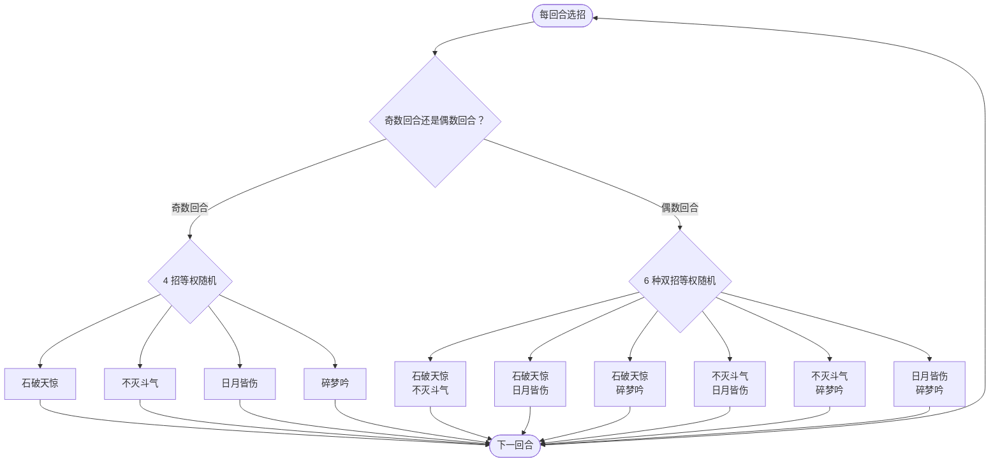

# 盖亚（幽暗之证）

> **类型**：特殊怪物（子地图变体）
> **初始生命**：276 - 286
> **遭遇战**：子地图「幽暗之证」普通节点 · 随机 1 只
> **特性**：与[盖亚](/monsters/boss/gaia_monster.md)技能、被动、动画、立绘完全一致，仅生命改为 276 - 286

## 与本体盖亚的区别

| 项目 | 本体盖亚 | 幽暗之证版 |
| --- | --- | --- |
| 生命 | 183 - 186 | 276 - 286 |
| 技能 / 被动 | 完整 | 完全继承，无改动 |
| 出场 | 第一层 Boss 池 | 只在幽暗之证房间 |

::: tip 血量口径
幽暗之证使用固定的旧版基础值（276~286），不随本体盖亚的数值调整同步。
:::

完整机制（返璞归真、暴击、血/天/邪横幅、偶数回合双招）见 **[盖亚](/monsters/boss/gaia_monster.md)**。

## 被动能力

- **返璞归真**：自身造成暴击时，回复等于该次暴击实际伤害的生命；多段攻击逐段结算。
- **暴击**：暴击伤害 ×1.5；暴击率来自自身命中，每层 +10%。开局 0% 暴击率，用「不灭斗气」叠命中后才会暴击。
- **横幅规则**：开局从血 / 天 / 邪三条规则中随机 1 条，顶部常驻显示，三种规则互斥且不可消除。血：受到伤害 ×2，第 3 回合起自身攻击 ×10000；天：受到非暴击伤害降至 40%、暴击伤害 ×3；邪：受到伤害减少（70 − 5×回合数）%，第 14 回合起为 0。

## 行动逻辑

开局自带返璞归真 + 暴击 + 横幅规则（血/天/邪三选一随机）。奇数回合从 4 个单招中等权随机 1 个；偶数回合从 6 种双招组合中等权随机 1 种，依次结算两招。

## 招式表

| 招式 | 意图 | 效果 | 数值 |
|---|---|---|---|
| 石破天惊 | 攻击 + 反转属性 | 造成伤害；自身速度 +2；把你全部正值属性翻成负值 | 伤害 16；速度 +2 |
| 不灭斗气 | 自身增益 | 自身全属性 +2；下次攻击必定暴击 | 全属性 +2 |
| 日月皆伤 | 攻击 + 双倍反弹 | 造成伤害；获得 1 层双倍反弹（下次受到攻击伤害时，把该伤害 ×2 反弹给你，随后消耗） | 伤害 12 |
| 碎梦吟 | 多段攻击 + 易伤 | 造成 4 点伤害 4 次；每次命中施加 1 层易伤 | 4 × 4 |
| 双招组合 | — | 石破天惊·不灭斗气 / 石破天惊·日月皆伤 / 石破天惊·碎梦吟 / 不灭斗气·日月皆伤 / 不灭斗气·碎梦吟 / 日月皆伤·碎梦吟，依次结算两招 | 与单招相同 |

## 遭遇战

| 遭遇战 | 房间类型 | 池子 | 数量 | 说明 |
|--------|----------|------|------|------|
| 幽暗之证 | Monster | 幽暗之证专属 | 1 只 | 从雷伊 / 盖亚 / 卡修斯 / 布莱克 / 缪斯五只翻倍版中随机 1 只 |

## 策略提示

1. **更厚的血条会拉长战斗**：盖亚的暴击与返璞归真回血会随战斗轮次累积，血量比本体更厚，等于给它更多回血与成长机会。拖得越久越难打，尽量速战。

2. **横幅规则仍然随机，三种都要会打**：血横幅必须在 3 个玩家回合内击杀（盖亚第 3 回合开始攻击 ×10000，血量更厚时容错更低）；天横幅要走暴击流，非暴击与固定伤害都会被压到 40%；邪横幅是逐回合递减减伤，第 14 回合起归零，拖得越久越好打。

3. **子地图无真正死亡**：打不过会恢复并退出子地图，不会丢局；但会浪费活动进度。血量更厚的盖亚值得提前备好减疗与高爆发。

4. **别把它当第一层 Boss 打**：它的招式数值还是第一层 Boss 级别，但生命约为本体的 1.5 倍；用第一层的节奏硬拼容易被回血拖死。

## 源码

- 怪物：`SeerGaiaDarkProofMonster.cs`（子类，仅覆盖生命）
- 遭遇战：`SeerDarkProofEncounter.cs`
- 本地化：`monsters.json`
