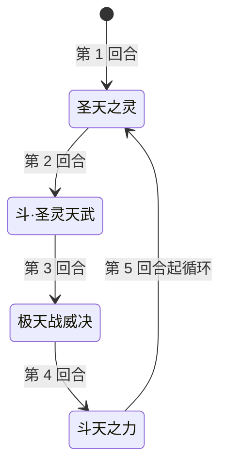

# 圣战·瑞尔斯（圣光的恩泽）

> **类型**：特殊怪物（子地图变体）
> **初始生命**：736
> **遭遇战**：子地图「圣光的恩泽」精英节点
> **特性**：与[圣战·瑞尔斯](/monsters/elite/holy_war_ruiersi_monster.md)技能、被动、动画、立绘完全一致，仅生命改为 736

## 与本体圣战·瑞尔斯的区别

| 项目 | 本体圣战·瑞尔斯 | 圣光的恩泽版 |
| --- | --- | --- |
| 生命 | 1354 | 736 |
| 技能 / 被动 | 完整 | 完全继承，无改动 |
| 出场 | 第三层精英池 | 只在圣光的恩泽精英节点 |

完整机制（斗·圣灵天武的封印、极天战威决、挫锐等）见 **[圣战·瑞尔斯](/monsters/elite/holy_war_ruiersi_monster.md)**。

## 被动能力

**圣战**（不可消除）：自身受到攻击伤害时，攻击者失去该次攻击实际伤害 1/6 的生命（无视格挡），自身回复等量生命。

- 只对攻击伤害触发；固定伤害、流失等非攻击来源不触发。
- 按实际掉血计算，被格挡吸收的部分不计入。

## 行动逻辑

纯固定循环，无任何随机：开场先放「圣天之灵」，之后按 斗·圣灵天武 → 极天战威决 → 斗天之力 → 圣天之灵 的顺序循环。四招等长，每 4 回合走完一圈。

## 招式表

| 招式 | 意图 | 效果 |
|---|---|---|
| 圣天之灵 | 自身免控 + 干扰 | 自身获得 5 回合免控；施加 5 回合圣灵削能：你每打出 1 张赛尔牌，该牌 PP −2，每扣 1 点 PP 造成 1 点固定伤害 |
| 斗·圣灵天武 | 攻击 45 | 反弱反强；造成 45 点伤害；自身获得圣武封灵：你下回合打出的第一张攻击牌与第一张技能牌无效 |
| 极天战威决 | 攻击 15 × 3 | 造成 15 点伤害 3 次；对你施加 4 回合挫锐（每回合开始先制 −1） |
| 斗天之力 | 自身增益 | 自身全属性 +2；获得 3 回合吃月亮；获得等于全属性提升后四项之和的格挡 |

## 遭遇战

| 遭遇战 | 房间类型 | 池子 | 数量 | 说明 |
|--------|----------|------|------|------|
| 圣光的恩泽（精英节点） | Elite | 圣光的恩泽专属 | 1 只 | 单怪；普通节点固定为斗神瑞尔斯（450 血） |

## 策略提示

1. **736 血远低于本体**：本体是 1354 血，这个活动版只有 736，战斗轮次会明显更短；真正的压力来自它在活动精英节点、失败会损失活动进度。封印循环每 4 回合来一次，每次都要交掉一张攻击牌和一张技能牌，拖得越久越容易被拖乱节奏。

2. **「无效」不是「无法打出」**：斗·圣灵天武让你打出的第一张攻击/技能牌**效果归零**，牌照样打出、能量照样付。由你自选哪张去「顶」，用低价值牌吃掉封印。

3. **极天战威决会降先制**：该招把「多回合先制」按负向使用，每回合 −1 先制。先制为负时出牌更贵，注意费用规划。

4. **子地图无真正死亡**：失败会恢复并退出子地图，不会丢局；但精英节点是活动进度的关键，尽量备好封印对策再来。

## 源码

- 怪物：`SeerHolyWarRuiersiHolyLightMonster.cs`（子类，仅覆盖生命）
- 遭遇战：`SeerHolyLightStrongEncounter.cs`
- 本地化：`monsters.json`
