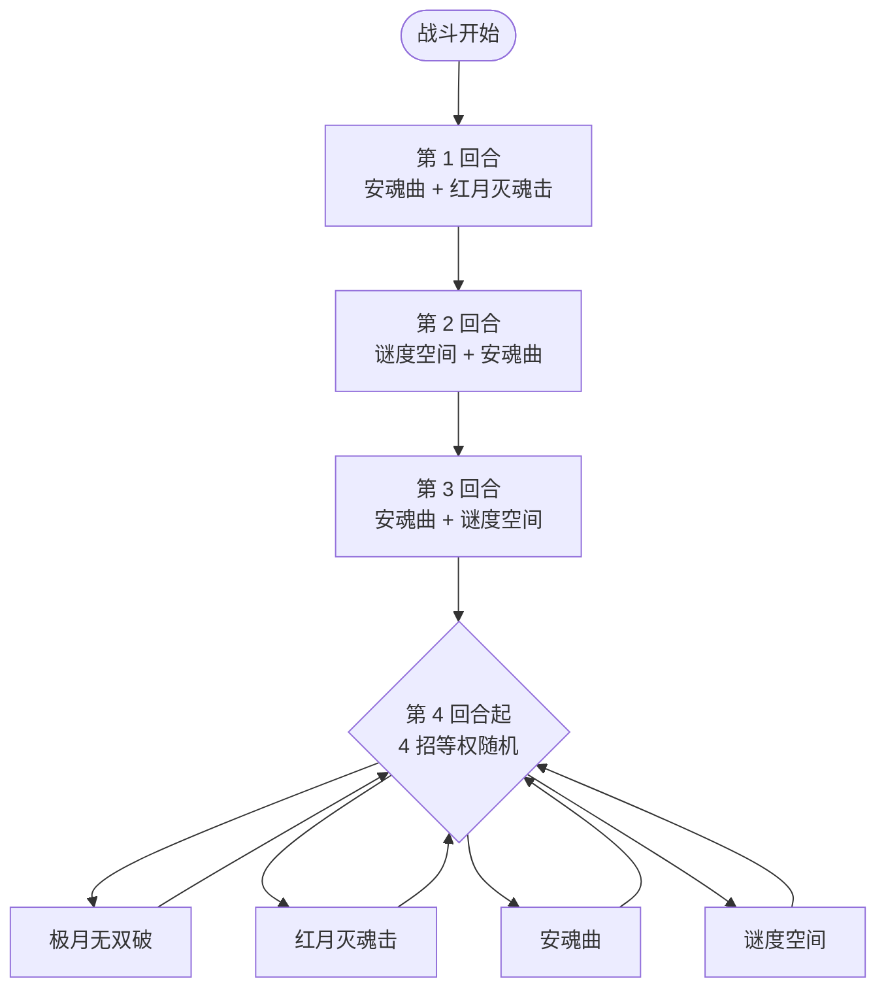

# 缪斯（幽暗之证）

> **类型**：特殊怪物（子地图变体）
> **初始生命**：326 - 336
> **遭遇战**：子地图「幽暗之证」普通节点 · 随机 1 只
> **特性**：与[缪斯](/monsters/boss/muse_monster.md)技能、被动、动画、立绘完全一致，仅生命改为 326 - 336

## 与本体缪斯的区别

| 项目 | 本体缪斯 | 幽暗之证版 |
| --- | --- | --- |
| 生命 | 210 - 213 | 326 - 336 |
| 技能 / 被动 | 完整 | 完全继承，无改动 |
| 出场 | 第一层 Boss 池 | 只在幽暗之证房间 |

::: tip 血量口径
幽暗之证使用固定的旧版基础值（326~336），不随本体缪斯的数值调整同步。
:::

完整机制（天蛇之瞳、前 3 回合固定双招、第 4 回合起随机单招）见 **[缪斯](/monsters/boss/muse_monster.md)**。

## 被动能力

**天蛇之瞳**：你每打出 7 张牌（安魂曲每次让阈值 −1，最低 1），从你的抽牌堆/手牌/弃牌堆随机注视 1 张未被注视的牌。

- 被注视的牌费用变为 X（打出时消耗全部当前能量）；打出后清除注视、PP 清空、进入消耗牌堆。
- 排除规范牌、状态牌、诅咒牌和带「不可打出」关键词的牌。
- 能力不可消除。缪斯施加的睡眠受到未被格挡的伤害时不会移除，只减少 1 层。

## 行动逻辑

前 3 回合是固定双招序列，顺序与组成都不随机；第 4 回合起改为 4 个单招等权随机，可连续重复同一招。

## 招式表

| 招式 | 意图 | 效果 | 数值 |
|---|---|---|---|
| 极月无双破 | 多段攻击 | 造成 6 点伤害（3 + 你正值属性种类数）次；力量/防御/命中/速度每有 1 种正值就 +1 次 | 6 ×（3 + 种类数） |
| 红月灭魂击 | 攻击 + 格挡 | 造成伤害；自身获得 30 点格挡 | 伤害 21；格挡 30 |
| 安魂曲 | 自身反击 + 加速注视 | 接下来 3 次受到未被格挡的攻击伤害时，令攻击者获得 2 层睡眠；天蛇之瞳阈值 −1 | 反击 3 次 |
| 谜度空间 | 削属性 + 扣 PP | 你全属性 −1；随机使你未被注视的牌共失去 9 点 PP（可重复命中同一张牌） | 全属性 −1；PP −9 |
| 安魂曲·红月灭魂击 | — | 先安魂曲后红月灭魂击 | 同上 |
| 谜度空间·安魂曲 | — | 先谜度空间后安魂曲 | 同上 |
| 安魂曲·谜度空间 | — | 先安魂曲后谜度空间 | 同上 |

## 遭遇战

| 遭遇战 | 房间类型 | 池子 | 数量 | 说明 |
|--------|----------|------|------|------|
| 幽暗之证 | Monster | 幽暗之证专属 | 1 只 | 从雷伊 / 盖亚 / 卡修斯 / 布莱克 / 缪斯五只翻倍版中随机 1 只 |

## 策略提示

1. **天蛇之瞳会多注视几轮**：每 7 张牌注视 1 张，血量更高意味着你要多打一轮以上的牌，额外被注视的牌也更多。关键牌尽量在早期打掉，别留到最后被锁。

2. **前 3 回合固定双招是危险窗口**：招式不变，但你要在这 3 回合内打掉更多血，承压更集中。提前准备格挡与解异常。

3. **第 4 回合后随机单招反而更好预判**：单招压力低于双招，更高血量下可以把这段当作稳定输出期，但仍要留防御应对高伤随机。

4. **子地图无真正死亡**：失败只会退出子地图，不会丢局；活动奖励才是目标，不要为它交掉关键资源。

## 源码

- 怪物：`SeerMuseDarkProofMonster.cs`（子类，仅覆盖生命）
- 遭遇战：`SeerDarkProofEncounter.cs`
- 本地化：`monsters.json`
