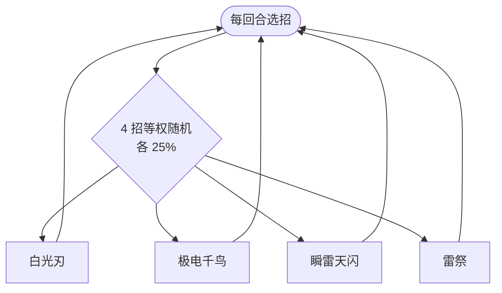

# 雷伊（幽暗之证）

> **类型**：特殊怪物（子地图变体）
> **初始生命**：236 - 246
> **遭遇战**：子地图「幽暗之证」普通节点 · 随机 1 只
> **特性**：与[雷伊](/monsters/boss/ray_monster.md)技能、被动、动画、立绘完全一致，仅生命改为 236 - 246

## 与本体雷伊的区别

| 项目 | 本体雷伊 | 幽暗之证版 |
| --- | --- | --- |
| 生命 | 140 - 143 | 236 - 246 |
| 技能 / 被动 | 完整 | 完全继承，无改动 |
| 出场 | 第一层 Boss 池 | 只在幽暗之证房间 |

::: tip 血量口径
幽暗之证使用固定的旧版基础值（236~246），不随本体雷伊的数值调整同步。
:::

完整招式表、被动「雷雨天」与行动逻辑见 **[雷伊](/monsters/boss/ray_monster.md)**，本页不重复。

## 被动能力

**雷雨天**：由 3 个不可消除能力（雷雨天、暴击、锁定II）加闪电充能球计数器共同实现。

- **雷雨天**：自身攻击必定暴击；每次造成伤害（含自伤）后，闪电充能球 +1。充能球造成的伤害不会再生成新球。
- **暴击**：暴击伤害 ×1.5。
- **锁定II**：自身暴击率固定为 100%。
- **闪电充能球**：开局 0 层，最多 2 个槽位；每次造成伤害 +1 球，满槽再生成先激发最旧的球（8 点伤害）；使用雷祭时生成本场累计生成数量的球，每球 8 点伤害，生成后累计数量翻倍。
- **球的被动**：自身回合结束时，每个球对随机敌人造成 3 点伤害（非攻击伤害，不触发暴击，也不会生成新球）。

## 行动逻辑

4 个招式完全等概率随机（各 25%），可连续重复同一招，没有血量门槛与固定序列。

## 招式表

| 招式 | 意图 | 效果 | 数值 |
|---|---|---|---|
| 白光刃 | 攻击 + 驱散 | 造成伤害；消除你的全部正值属性，同时把自身负属性归零 | 伤害 10（必暴） |
| 极电千鸟 | 多段攻击 | 造成 4 点伤害 4 次；每次造成未被格挡的伤害后自身力量 +1 | 4 × 4（必暴） |
| 瞬雷天闪 | 攻击 + 异常 | 造成伤害；你获得 3 层瘫痪，自身获得 3 层超频 | 伤害 12（必暴） |
| 雷祭 | 自伤 + 充能球 | 自身受到 3 点伤害 3 次；生成等于本场累计生成数量的闪电球，每球 8 点伤害（非攻击伤害，不吃暴击/力量） | 自伤 3 × 3 |

## 遭遇战

| 遭遇战 | 房间类型 | 池子 | 数量 | 说明 |
|--------|----------|------|------|------|
| 幽暗之证 | Monster | 幽暗之证专属 | 1 只 | 从雷伊 / 盖亚 / 卡修斯 / 布莱克 / 缪斯五只翻倍版中随机 1 只 |

## 策略提示

1. **血量更高会改变爆发阈值**：本体雷伊是 140~143 血的速杀目标，这里固定为 236~246，约为本体血量的 1.7 倍，原本一回合能收掉的血线现在收不掉。按「接近 1.7 管本体血」重新规划爆发。

2. **招式不变，威胁密度不变**：它仍然是 4 招等概率随机，不会因为血量更高多出新机制。难点是战斗轮次变长，随机到高伤招式的次数变多。

3. **子地图没有死亡惩罚**：子地图内玩家生命归零不会真正死亡，会恢复并退出子地图；但打空这场的收益只是活动进度，不值得为它交掉关键药水/遗物。

4. **活动奖励才是目标**：幽暗之证的核心产出是通关活动后的史诗/传说遗物，这场只是路障。能稳过即可，不必追求无伤。

## 源码

- 怪物：`SeerRayDarkProofMonster.cs`（子类，仅覆盖生命）
- 遭遇战：`SeerDarkProofEncounter.cs`
- 本地化：`monsters.json`
