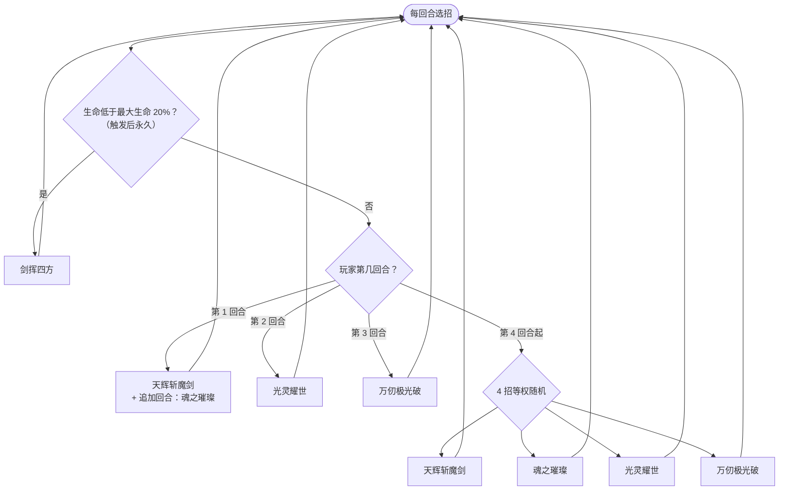

# 六界帝神（界王神灵·普通档）

> **类型**：特殊怪物（子地图变体）
> **初始生命**：325
> **遭遇战**：子地图「界王神灵」普通节点
> **特性**：与[六界帝神](/monsters/elite/six_realm_god_monster.md)技能、被动、动画、立绘完全一致，仅生命改为 325

## 与本体六界帝神的区别

| 项目 | 本体六界帝神 | 界王神灵·普通档 |
| --- | --- | --- |
| 生命 | 754 | 325 |
| 技能 / 被动 | 完整 | 完全继承，无改动 |
| 出场 | 第三层精英池 | 只在界王神灵普通节点 |

完整机制（诛邪、固定回合序列、20% 血以下剑挥四方）见 **[六界帝神](/monsters/elite/six_realm_god_monster.md)**。

## 被动能力

**诛邪**（不可消除）：你每有 1 层堕落，自身造成的伤害提高 1%，按你当前堕落层数动态计算。

## 行动逻辑

前 4 个自身行动固定为 天辉斩魔剑 → 魂之璀璨 → 光灵耀世 → 万仞极光破。天辉斩魔剑结束时立即追加 1 个回合，追加回合会把下一个行动（魂之璀璨）直接执行掉，所以按玩家回合看是：第 1 回合天辉 + 魂之璀璨，第 2 回合光灵耀世，第 3 回合万仞极光破，第 4 回合起四招等权随机。生命低于最大生命 20%（325 × 20% = 65）后，当回合立即改打「剑挥四方」，之后永久只打这一招。

> 随机阶段的「天辉斩魔剑」同样会追加回合，追加回合取下一招（可能又是天辉，从而连锁追加），这是它最危险的随机结果。

## 招式表

| 招式 | 意图 | 效果 |
|---|---|---|
| 天辉斩魔剑 | 攻击 + 异常 | 造成 54 点伤害；随机施加 2 种异常各 2 回合；自身回合结束后立即额外开启 1 个回合 |
| 魂之璀璨 | 自身增益 | 自身全属性 +6；获得 4 回合吃月亮 |
| 光灵耀世 | 自身免控 + 干扰 | 5 回合内自身免控；每次受到伤害获得 1 层缓冲；你的赛尔牌 PP 消耗变为 5 倍 |
| 万仞极光破 | 多段攻击 + 增益 | 先反弱反强；造成 6 点伤害 6 次；获得 6 层缓冲 |
| 剑挥四方 | 攻击 + 死亡反噬 | 造成 48 点伤害；效果期内自身死亡则把你生命降至 1 |

## 遭遇战

| 遭遇战 | 房间类型 | 池子 | 数量 | 说明 |
|--------|----------|------|------|------|
| 界王神灵（普通节点） | Monster | 界王神灵专属 | 1 只 | 单怪；精英节点固定为六界帝神（840 血） |

## 策略提示

1. **325 血是精英本体的四成多**：机制全是精英级，血量只有 754 的约 43%。把它当精英打，不要因为血少就省防御。

2. **20% 血以下会改用剑挥四方**：它会在低血时进入特殊循环；剑挥四方会给它挂 2 回合的反噬，效果期内被击杀会把你生命降到 1。收尾阶段要留免疫/斩杀，别在 65 血以下放松，也别在它刚放完这一招时贸然收尾。

3. **界王神灵是纯六界帝神节点**：普通与精英节点都是它，普通档就是活动前半程的固定路障，稳过即可。

4. **子地图无真正死亡**：失败会恢复并退出子地图，不会丢局；但会损失活动进度。

## 源码

- 怪物：`SeerSixRealmGodWeakMonster.cs`（子类，仅覆盖生命）
- 遭遇战：`SeerSixRealmGodWeakEncounter.cs`
- 本地化：`monsters.json`
